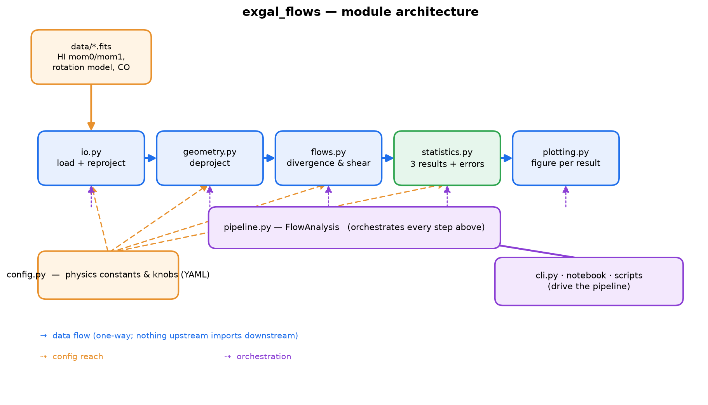
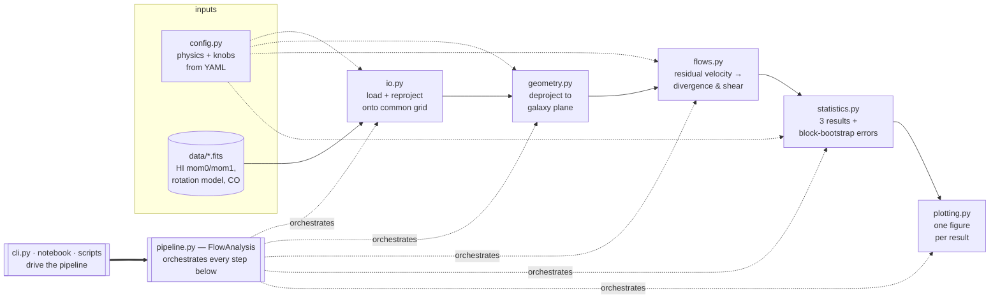

# exgal_flows — architecture on one page

**What it does.** Tests whether cold molecular gas (CO) preferentially forms
where the neutral-gas velocity field is *converging* (colliding flows) and is
suppressed where it *shears*, in the disk of M33, on 50–100 pc scales.

**Design rule.** Single-responsibility modules with a **one-way dependency
arrow**: nothing upstream imports anything downstream. `geometry` doesn't know
statistics exist; `statistics` never opens a file. That is what makes each
piece unit-testable in isolation and lets a collaborator swap one part (a new
galaxy's geometry, a new statistic) without touching the rest.

## Dependency & data flow

*Solid blue = data flow (one-way; nothing upstream imports downstream).
Orange = config reach. Purple = orchestration: `pipeline` drives every step;
`cli`/notebook/scripts drive `pipeline`.*

Same diagram as Mermaid source (editable)

*Solid arrows = data flow. Dotted = config/orchestration reach. `pipeline`
calls the row above; `cli`/notebook/scripts call `pipeline`.*

## Modules (`src/exgal_flows/`)

| Module | Responsibility | Key entry points |
|--------|----------------|------------------|
| `config.py` | Every physics constant & analysis knob in dataclasses; unifies the notebook's scattered (sometimes inconsistent) hardcoded values. | `load_config(path)` → `Config`; `GalaxyConfig`, `AnalysisConfig` |
| `io.py` | Load HI mom0/mom1, rotation model, CO peak maps; **reproject** all onto the HI grid. Carries `pixel_scale_pc` (the pixel↔pc key). | `load_maps(...)` → `Maps` |
| `geometry.py` | Pure coordinate math: shift/rotate/stretch (1/cos i) to the galaxy plane; build radius & azimuth grids. No files touched. | `deproject()`, `polar_grid()` |
| `flows.py` | Subtract rotation model → residual velocity; spatial gradients → **divergence** (neg = colliding) and **shear**; re-derive after smoothing. | `velocity_gradients()`, `smoothed_velocity_field()` |
| `statistics.py` | The three results + honest error bars. Wedge block-bootstrap and the tiled **spatial** block bootstrap for the radial profile. | `divergence_of_co_bright()`, `co_fraction_vs_gradient()`, `tiled_block_bootstrap_radial_profile()` |
| `pipeline.py` | `FlowAnalysis` ties steps 2–5 together; holds intermediate maps; centralizes pixel↔pc conversions. | `FlowAnalysis.from_files(...)`, `.result_divergence_of_co()`, `.result_co_vs_shear()`, `.resolution_study()`, `.radial_divergence_profile()` |
| `plotting.py` | One function per result; takes a *result object* + optional `ax`, never recomputes. | `plot_divergence_of_co_bright()`, `plot_co_fraction_vs_gradient()`, `plot_resolution_study()`, `plot_radial_divergence_profile()` |
| `cli.py` | Command-line front door: `from_files` → results → figures. | `exgal-flows` console command |

## The three science results → the call that produces each

| # | Claim | Call |
|---|-------|------|
| 1 | CO sits at **colliding** flows (negative divergence, steepening with CO brightness) | `ana.result_divergence_of_co()` |
| 2 | **Shear suppresses** CO (CO-bright fraction falls with \|shear\|) | `ana.result_co_vs_shear()` |
| 3 | The signal lives at **50–100 pc** (survives smoothing to ~100 pc, washes out by ~150) | `ana.resolution_study()` |
| + | Radial trend with **honest** (spatially-correlated) errors; sign flips at a turnover radius ≈ 1173 pc | `ana.radial_divergence_profile()` |

## Supporting cast

- **`config/m33.yaml`, `m33_old.yaml`** — new (5.3″) vs old (8.2″) HI epochs. Same physics, different beam; aperture & smoothing are set in **parsecs**, so the two are directly comparable.
- **`tests/`** — `test_geometry_flows.py`, `test_statistics.py`, `test_config.py`, `conftest.py`. 18 tests, all passing.
- **`notebooks/reproduce_results.ipynb`** — narrative reproduction: imports the package, tells the story; the package guarantees the numbers.
- **`scripts/compare_epochs.py`** — both HI epochs through the identical matched-aperture path.
- **`FINDINGS.md`** — science memo: the three results, the epoch comparison, the **aperture bug**, and the block-bootstrap conclusion.
- **`pyproject.toml` / `.gitignore`** — install metadata + `exgal-flows` entry point; keeps `data/` and `outputs/` out of git.

## Two things that make the analysis correct

1. **Everything is physical, not pixel-based.** The aperture, smoothing, and annulus edges are in parsecs (via `pixel_scale_pc`), so results are resolution-independent — the reason the notebook's `rmax=300 pixels` bug (916 pc on the new data vs ~3600 pc on the old) mattered, and why it's fixed to `radius_max_pc = 4000`.
2. **Errors respect spatial correlation.** The maps are correlated on a range of scales, so the per-pixel iid bootstrap understates uncertainty by ~10×. The block bootstraps (azimuthal wedges; tiled spatial blocks) resample *whole correlated regions*, giving confidence intervals you can trust.
